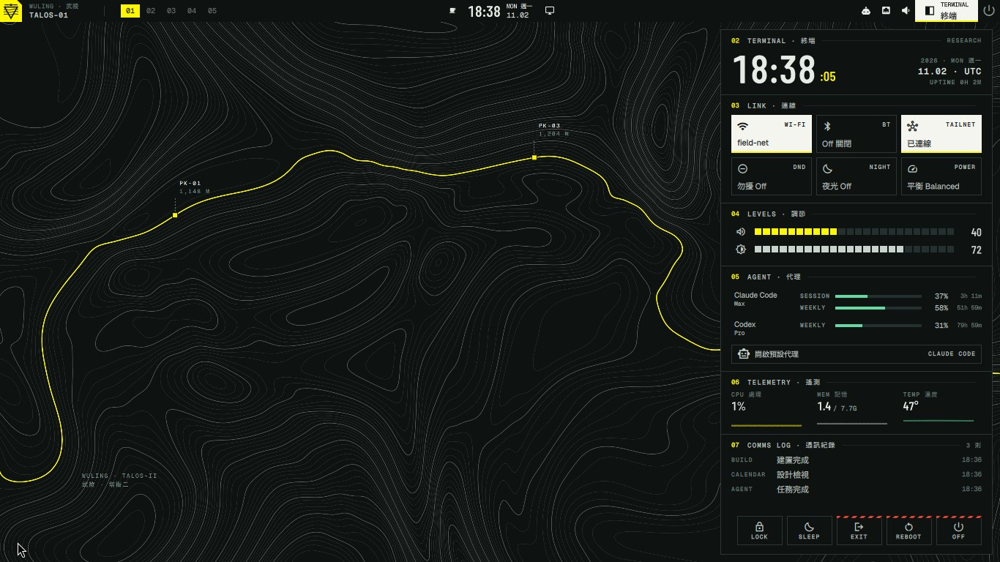
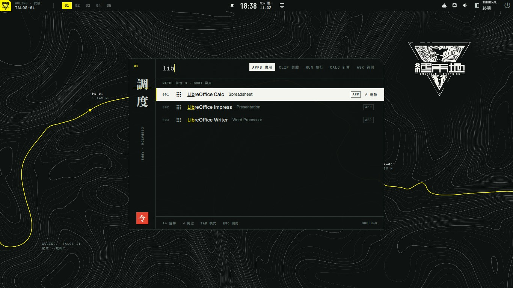
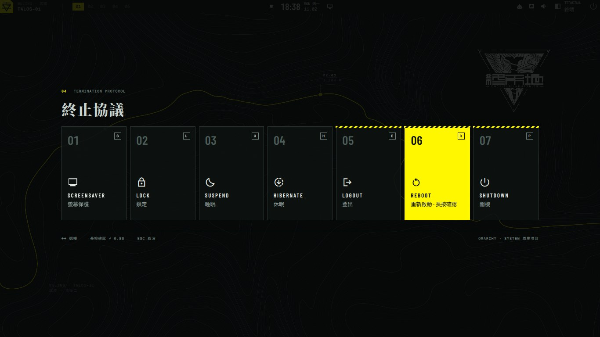
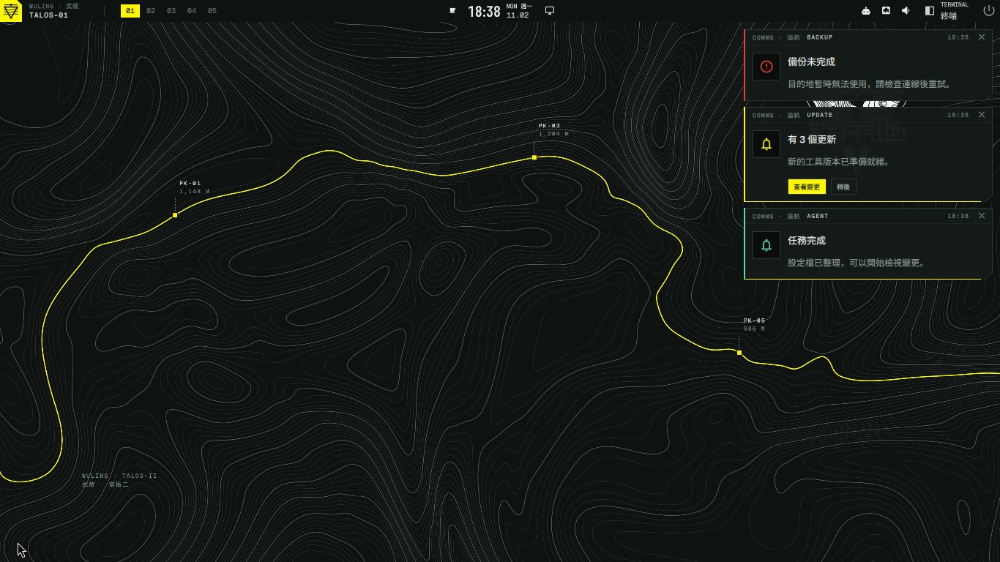
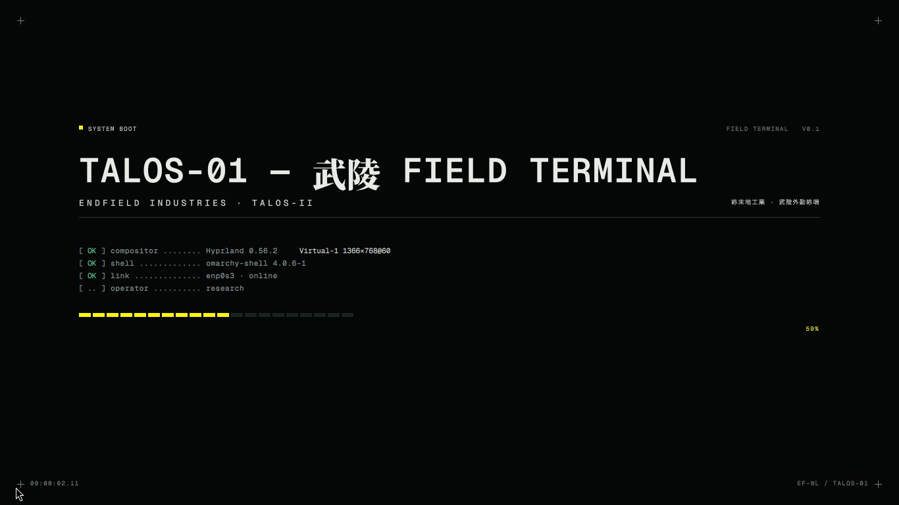
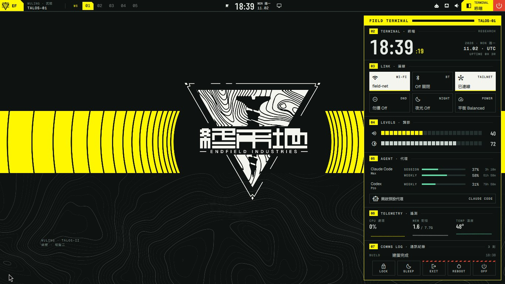
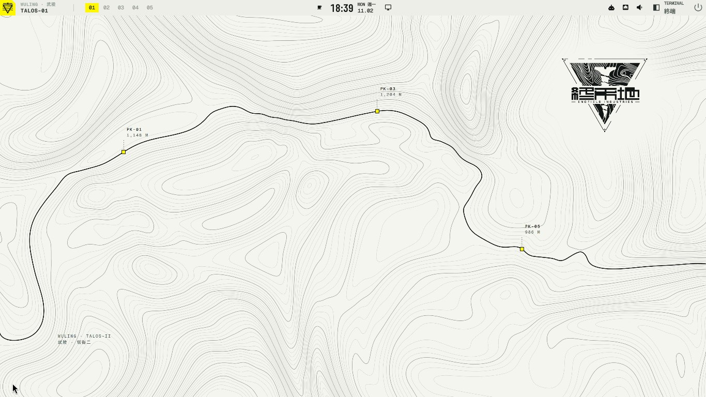

# WULING for Omarchy

武陵外勤終端. A field-terminal desktop for [Omarchy](https://omarchy.org), styled after the Wuling region of *Arknights: Endfield*.

WULING is a set of Omarchy themes and independent omarchy-shell plugins. Omarchy stays in charge: the same keys, menus, login and updates. WULING changes how it looks and adds a few things Omarchy doesn't have. Every part can be switched off, and switching it off gives you Omarchy's own back.



## What you get

| | |
|---|---|
| **Bar** | Hosts Omarchy's own widgets, so every click and panel works as it does in Omarchy |
| **Terminal** (Super+Ctrl+G) | A panel with the clock, Wi-Fi, Bluetooth, Tailscale, levels, the player, agent usage, telemetry and the notification log. Every item opens its own page in the panel: performance, power, audio, system, calendar, Wi-Fi, Bluetooth, Tailnet, notifications and WULING's settings. Collects nothing while closed |
| **Keymap** (Super+Ctrl+/) | Every key bound right now, Omarchy's and your own, on one screen. Type to filter |
| **Dispatch** (Super+D) | A launcher with five modes: apps, clipboard, run, calculator and ask your agent. Super+Space stays Omarchy's menu |
| **Power menu** (Super+Esc) | Omarchy's own entries as cards. Logout, reboot and shutdown need a 0.8 s hold |
| **Notifications and OSD** | Answer the same IPC and keys as Omarchy's, and follow the rules of the Omarchy version you have installed |
| **Arrival and exit** | Animations at the start and end of a session, layered over Omarchy's login logic, which is untouched. A theme switch plays the same ink wave when the old look can be caught in time, otherwise Omarchy's own transition. Each can be switched off |
| **Sounds** | Short synthesised cues, optional login music of your own (off by default) |
| **Themes** | `wuling`, `wuling-paper`, `wuling-hud` and `wuling-hud-paper`, switched with Omarchy's own theme switcher. They also cover Omarchy's menus, panels, lock screen, authentication dialog, apps and boot unlock. Other Omarchy themes keep working, with their own palette |

Interface text comes in English, Traditional Chinese and Simplified Chinese.

| | |
|---|---|
|  |  |
|  |  |
|  |  |

## Install

You need Omarchy 4. It's tested on 4.0.6 and 4.5.0. On any other version the installer says so and asks, and anything that depends on a changed part of Omarchy stays on Omarchy's own.

```sh
git clone https://github.com/Mizimo/wuling-omarchy.git
cd wuling-omarchy
./install
```

The installer prints what it will change and asks first. It needs no `sudo` and edits no Omarchy files. It starts you on the `wuling` theme; the other three are in Omarchy's theme switcher.

The boot unlock screen is one step Omarchy keeps behind `sudo`, so it stays yours to run: `omarchy plymouth set-by-theme wuling`.

To remove everything: `wuling uninstall`. Your settings file stays.

## Keys

WULING adds three keys and changes none of Omarchy's. The installer won't overwrite a binding of your own.

| Key | Does |
|---|---|
| Super+Ctrl+G | Terminal |
| Super+D | Dispatch |
| Super+Ctrl+/ | Keymap |

## Settings

`wuling config set KEY VALUE`, or edit `~/.config/wuling/overrides.toml`. Updates never replace that file.

| Key | Values | Default |
|---|---|---|
| `language` | `auto`, `en`, `zh-Hant`, `zh-Hans` | `auto` |
| `sounds` | `essential`, `full`, `off` | `essential` |
| `motion` | `full`, `reduced` | `full` |
| `labels` | `true`, `false` | `true` |
| `menu.selected` | `edge`, `fill` | `edge` on the dark themes, `fill` on PAPER |
| `terminal.sections` | any of `clock link levels signal agent telemetry comms` | all |
| `session.arrival`, `session.exit`, `session.theme` | `true`, `false` | `true` |
| `login_music` | a path | unset |

To switch off a whole part: `omarchy plugin disable wuling.dispatch`. The parts are `wuling.bar`, `wuling.terminal`, `wuling.notifications`, `wuling.osd`, `wuling.dispatch`, `wuling.power`, `wuling.session`, `wuling.sound` and `wuling.keymap`.

`wuling doctor` checks the installation and says what's wrong.

## For agents and developers

`AGENTS.md` is the entry point. `wuling commands --json` describes every command, and they all answer in JSON. `design/DESIGN.md` is the specification, `design/DECISIONS.md` the decisions behind it, and `research/` what was tested against which Omarchy version. `tools/check` runs the checks.

## 中文

武陵外勤終端：給 Omarchy 的桌面，以《明日方舟：終末地》的武陵為主題。它是一組 Omarchy 主題和獨立的 omarchy-shell 外掛，快捷鍵、選單、登入和更新都還是 Omarchy 的；每個部分都可以單獨關掉，關掉就回到 Omarchy 原本的。

安裝：`git clone` 之後執行 `./install`，它會先列出要改的東西再問你，不需要 `sudo`，也不改 Omarchy 的檔案。移除：`wuling uninstall`。語言：`wuling config set language zh-Hant`。新增的快捷鍵只有三個：Super+Ctrl+G 開 Terminal，Super+D 開 Dispatch，Super+Ctrl+/ 開鍵位總覽。

## License

GPL-3.0-or-later, see [LICENSE](LICENSE). Bundled fonts keep their own licenses (SIL OFL 1.1, Apache-2.0).

*Arknights: Endfield* and its names, logos and quotations belong to Hypergryph / GRYPHLINE. WULING is an unofficial fan project, not affiliated with or endorsed by them. Official scene art and music are never included in this repository.
